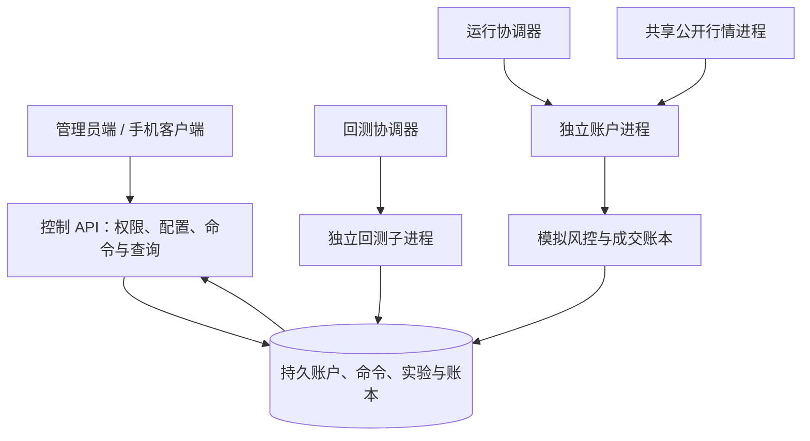

# MK Quant · 数字货币量化策略框架

MK Quant 是面向 Binance USDT / USDC 现货与 U 本位永续的量化研究和账户管理框架。它把行情下载、策略参数、回测验证、实验记录、模拟执行和客户报表整合到同一套工作台，让策略开发者主要关注交易逻辑。

项目包含 React 管理员端、适配手机的客户页面、FastAPI 控制服务、独立回测进程、逐账户模拟进程及持久化账本。管理员统一开通账户；客户只能访问自己的账户，没有公开注册入口。

**当前可运行的是回测与持续模拟闭环，正式实盘执行保持关闭。** 已提供 Binance 签名接口、账户接入检查、设置调整和订单去重组件，但真实交易所事件流对账、保护单执行、运行期授权与故障接管仍待完成生产验收。`MK_ENABLE_LIVE=1` 不能绕过应用层阻断。

## 功能概览

| 模块 | 已提供的能力 |
| --- | --- |
| 总览与账户 | 权益、收益、保证金占用、持仓、订单、运行状态、收益曲线；缺失和过期数据明确标记。 |
| 行情数据 | 持久后台任务下载 Binance 公开现货/永续 K 线，支持 USDT/USDC，仅下载 1 分钟基础数据；切页和刷新后恢复进度与禁用状态；导入本地 JSON/简单 CSV；显示数据起止时间和内容版本，可删除未被实验引用的数据集。 |
| 策略管理 | 粘贴或上传 Python 策略，静态检查市场、币种、资金、杠杆、持仓模式及参数契约；默认参数自动生成表单。 |
| 回测工作台 | 独立回测集与验证集，市价下一根开盘或 Maker 限价订单簿模型，费用/滑点/交易规则快照，运行进度和分批曲线，完成后计算完整指标；汇总及各交易对的指标、曲线和训练/验证对比。 |
| USDC 双向网格 | 五种 USDC 永续任意非空子集、固定锚点等比网格、双向独立 lot、GTX 入场/止盈与条件限价止损；仅回测和模拟，明确显示触发未成交风险。 |
| 实验记录 | 服务端配置预设、复制配置、参数网格队列、取消/失败/重跑、结果比较、分页决策/成交追踪和完整 JSON/CSV 及图表 SVG 导出。 |
| 持续模拟 | 一个账户一个策略实例，实例可交易多个币种；停止开仓、平仓并停止、恢复运行通过持久化命令取得执行端回执。 |
| 客户端 | 随机账户链接、登录与归属鉴权、手机资金卡片、风险和订单；管理员可复制客户链接。 |
| 界面与协议 | 日间/夜间主题、北京时间 K 线、回测区间与实验记录显示、策略接入文档及后续接口规划。 |

完整状态与限制见 [实现范围与验收清单](docs/ACCEPTANCE.md)，策略开发见 [策略接入协议 v1.3](docs/STRATEGY_PROTOCOL.md)，网格参数与撮合规则见 [USDC 网格说明](docs/GRID_STRATEGY.md)，交易所覆盖范围见 [Binance 适配器文档](docs/BINANCE.md)。

## 快速开始

平台核心数据库仅使用 **MySQL / InnoDB**。开发、集成验证与生产共用同一套 schema、严格 SQL 模式、UTC 会话时区和 READ COMMITTED 事务隔离；没有文件数据库或内存数据库回退。当前部署与集成验证使用 MySQL 5.7.44。

先准备独立的开发数据库和仅有该库权限的用户，设置 `MK_DB_HOST`、`MK_DB_PORT`、`MK_DB_NAME`、`MK_DB_USER`、`MK_DB_PASSWORD`，以及可写的 `MK_ARTIFACT_ROOT`。可以使用已有 MySQL，也可设置私有 `MK_DB_PASSWORD` / `MK_DB_ROOT_PASSWORD` 后运行 `docker compose -f compose.database.yaml up -d`：开发库为本机 3307 的 `mk_quant_dev`，集成库为 3308 的 `mk_quant_test`，两者使用独立用户和卷。完整步骤见 [数据库与文件存储](docs/DATABASE.md)。


准备 Python 3.11、Node.js 22 和 npm。在项目根目录执行：

```bash
python3 -m venv .venv
.venv/bin/python -m pip install -r requirements.txt
npm ci --prefix frontend
./scripts/dev.sh
```

访问 [本地工作台](http://127.0.0.1:5173/)。开发脚本启动控制 API、回测协调器、模拟协调器和前端开发服务；API 仅绑定 `127.0.0.1:8765`。

开发脚本默认启用本地演示模式。首次初始化演示数据库时生成随机密码，并只在创建成功时向终端输出；已有数据库不会被重置。请保存首次输出，仓库没有固定管理员密码。需要手动初始化时运行：

```bash
.venv/bin/python -m backend.worker init-demo --generate-password
```

也可以通过 `MK_DEMO_PASSWORD` 提供自己选择的演示密码，至少 10 个字符。不要将真实密码写入源码、版本库或截图。演示客户为 `demo1` 至 `demo5`，演示初始化使用同一份本地生成的演示密码；所有示例资金、实验和行情均为合成数据，演示账户不能直接启动持续运行。测试持续模拟时，由管理员创建独立模拟账户。

### 使用空数据库

先创建管理员，再启动服务。交互式命令不会把密码放入命令行参数：

```bash
export MK_DEMO=0
export MK_DB_NAME=mk_quant_dev
export MK_DB_USER=mk_quant_dev
# 其余连接变量由本机私有环境提供
.venv/bin/python -m backend.worker create-admin
./scripts/dev.sh
```

自动初始化可使用 `create-admin --username admin --generate-password`，仅在创建成功时输出一次生成的口令；已有用户名会拒绝覆盖。不要将该输出写入公共日志。

本地 `.env` 不会自动载入，应用读取进程环境变量；`.env.example` 用于说明配置。开发脚本退出时会停止其启动的子进程，服务器需使用独立进程管理器。

## 运行架构



控制服务与策略执行分离。关闭网页、退出管理员登录或只重启 API，不会主动停止独立启动的模拟服务。页面状态来自执行进程的心跳、租约与命令回执。回测和运行进程应分配独立资源预算；每个账户的策略在独立子进程执行。

历史行情下载先入 MySQL 的 `data_download_jobs`，由 `backtest` 研究进程在回测任务之间调度独立下载子进程。`POST /api/datasets/download` 返回 `202` 和任务编号；通过 bootstrap 的 `download_jobs` 或 `GET /api/datasets/download-jobs/{id}` 查询结果。全平台同时最多一个活动下载，同配置重复提交复用活动任务；客户端提供 `request_key` 可在网络重试时复用已经完成的提交。下载中按钮保持禁用，任务完成后数据集才可用；失败显示原因并支持载入配置重试。API 重启不会终止独立下载；下载执行者失效后，研究进程按租约重新执行，含首次执行在内最多三次尝试，不承诺从断点字节续传。

新下载和导入统一为 `1m`；新回测拒绝旧的小时/日线数据，旧实验仍可查看。策略通过 `MANIFEST.timeframes` 声明主周期及辅助周期，由连续且已收盘的分钟 K 线按 UTC 交易所分桶合成；只有完整主周期收盘时调用策略，每一分钟都检查既有委托。所有模拟成交价格必须位于当分钟 `[low, high]` 内，含端点且成交量大于零；不把跳空未触及的限价记作成交，也不把超出区间的滑点价格截到边界伪造成交。

交互页面使用保留区间极值的曲线预览，统计使用完整数据；决策与成交按需分页。完整 JSON 报告及汇总/逐币权益 CSV 采用流式读取 Parquet，不随页面轮询反复展开全部明细。

下载不设总根数限制，由后台按页获取并流式写入 Parquet，内存不随全部 K 线累积。按交易所动态权重主动延时，遇到 429/418 遵守完整 Retry-After，等待期间保持任务租约并显示原因和重试时间。默认 900 秒无进展看门狗仅终止卡住的任务，不是下载总时限；Linux 地址空间默认上限 768 MB，磁盘默认预留 128 MB。Parquet 文件校验完成后，数据集引用、任务完成状态和审计记录在同一事务提交，旧租约不能发布结果。

管理员可在数据集列表删除未被实验引用的记录，同时清理对应 K 线 Parquet、返回实际释放字节数。已有实验引用时需先删除相关实验。实验记录支持删除已完成、失败或已取消的实验，并清理其权益曲线、订单、决策明细；排队和运行中的任务不能删除。相同内容文件由多条记录共享时，仅最后一份引用删除后回收。原始数据集不会随实验删除，下载及审计记录保留。文件清理失败会记录待重试任务，并在服务启动时重新检查引用后重试。

回测与模拟复用策略接口、账户账本、交易意图和指标。默认 `market_next_open_v1` 沿用单向市价、合约全仓及无杠杆现货；`maker_grid_v1` 支持合约双向全仓、持久限价/条件限价委托、逐 lot 保护和挂单资金预留。资金费、强平、真实盘口队列、部分成交和逐仓结算尚未建模。USDT 与 USDC 在模拟账本按等值 U 计价。

Maker 模型使用完整 1m K 线、下一分钟有效、价格落在分钟高低区间内才全量成交；入场成交即建 TP/SL，保护最早下一根有效，同根退出顺序不明时止损优先。止损触发后仍可能拒绝或未成交，无 Taker 回退。暂停保留保护；被动“平仓并停止”未成交时保持 `flattening`，直到实际模拟退出才确认停止，不能保证即时退出。

## 策略接入

策略文件通过 `MANIFEST` 声明名称、版本、市场、币种约束、账户要求和参数定义，并实现协议约定的策略类与回调。框架提供当前闭合行情、历史窗口、账户/持仓快照、日志和展示扩展；策略返回交易意图，由执行器检查资金、价格数量精度与风险约束。

内置示例位于 `backend/strategies/`。开发新策略时，先参照 [完整协议与示例](docs/STRATEGY_PROTOCOL.md)，在策略管理中保存，再选择数据与区间回测。每个实验绑定策略源码哈希、参数、数据内容哈希、引擎版本、成本假设、随机种子和运行环境，方便复现与比较。

内置 `usdc_hedge_grid` 支持 BTCUSDC、ETHUSDC、SOLUSDC、BNBUSDC、XRPUSDC 任意非空子集。界面默认资金 10,000 U、每格 100 U；策略按币均分保证金预算并逐层交替多空挂单。Maker 费用默认估计 0.02%、滑点固定为 0，交易规则按快照校验；这些默认值不是收益承诺或交易所真实成本认证。当前官方资料支持 USDC 永续 Hedge 的接口设计，但未做真实账户验收，证据与接入缺口见 [网格说明](docs/GRID_STRATEGY.md#binance-官方边界与后续接入)。

管理员保存的策略代码视为可信 Python。静态契约校验和进程资源限制不构成恶意代码沙箱；不要向不受信任的人开放策略上传权限。

## 配置与数据

| 环境变量 | 用途 |
| --- | --- |
| `MK_DB_HOST` / `MK_DB_PORT` | MySQL 地址与端口，端口默认 3306；应用数据库不直接暴露公网。 |
| `MK_DB_NAME` / `MK_DB_USER` / `MK_DB_PASSWORD` | 按环境隔离的业务库与专用用户，缺少配置直接失败。 |
| `MK_DB_SSL_CA` | 非回环远程数据库的可信 CA，校验证书与服务器身份；SSH 隧道及回环连接由本机边界保护。 |
| `MK_ARTIFACT_ROOT` | 独立 Parquet 文件根目录，三个服务共享；禁止作为公网静态目录。 |
| `MK_TEST_ALLOW_RESET` | 仅专用 `_test` 库设置 `1`，允许集成测试清理测试表。 |
| `MK_BACKTEST_ADDRESS_SPACE_MB` | 回测子进程虚拟地址上限，默认 2048 MB；不等于物理内存配额。 |
| `MK_DOWNLOAD_MEMORY_MB` / `MK_DOWNLOAD_STALL_SECONDS` | 下载子进程地址空间和无进展时限，默认 768 MB / 900 秒；旧 `MK_DOWNLOAD_TIMEOUT_SECONDS` 作为后者别名。 |
| `MK_DOWNLOAD_DISK_RESERVE_MB` | 分页落盘时保留的可用磁盘，默认 128 MB；空间不足明确失败且不发布残缺数据集。 |
| `MK_DEMO` | `1` 启用合成演示数据；公网部署使用 `0`。 |
| `MK_DEMO_PASSWORD` | 仅供新演示数据库初始化的自定义密码；可由初始化命令生成，不设固定默认值。 |
| `MK_MASTER_KEY` | Fernet 主密钥，录入实盘凭据时需要；独立保存和备份，不能写入策略或源码。 |
| `MK_ALLOWED_ORIGINS` | 浏览器允许来源，逗号分隔，含协议、主机和端口。 |
| `MK_COOKIE_SECURE` | HTTPS 环境设为 `1`，本机 HTTP 开发为 `0`。 |
| `MK_ENABLE_LIVE` | 保持 `0`；当前应用仍阻断正式实盘启动。 |
| `MK_ACCOUNT_MEMORY_MB` | Linux 单账户进程地址空间上限，默认 384 MB。 |

用户、账户、不可变策略版本、运行实例、控制命令、交易订单、成交、资金账本和审计记录统一保存在 MySQL，所有业务表显式使用 InnoDB。唯一索引、外键、行锁和事务维护账户唯一执行者及成交写入一致性。

历史 K 线、回测完整曲线、订单与决策明细使用不可变 Parquet 文件，MySQL 保存内容版本、文件校验值和统计摘要。文件完成写入并持久化后才提交数据库引用；文件缺失或校验错误会明确失败。大曲线在列表/运行视图使用保留分桶极值的预览，最终统计与导出仍读取完整数据。备份使用 `deploy/backup.py`，同时包含 InnoDB 一致性 SQL 快照和独立文件；不能只备份其中一侧。

行情时间以 Unix 时间戳存储，K 线和研究区间在界面使用北京时间（`Asia/Shanghai`）。每日/月度运行收益当前仍按 UTC 权益基准计算，不能把界面显示时区理解为统计结算时区已经切换。

客户端地址使用 32 位随机十六进制标识，并在服务端逐次验证账户归属。密码使用 scrypt，会话使用 HttpOnly Cookie，写请求校验 CSRF 与请求来源。随机链接无法代替登录和权限控制。

## 部署

- [宝塔原生部署](deploy/BAOTA.md)：分别管理 API、回测和模拟 Python 项目，Nginx 提供 HTTPS 静态入口与同源代理。
- [Docker Compose 部署](deploy/README.md)：单机容器部署，独立资源限制及共享持久数据卷。

生产配置、管理员凭据、交易密钥、数据库、日志和备份不属于公开仓库。部署文档中的地址均为占位示例；请在自己的服务器配置真实域名和环境。不要在公网启用演示账户。更新源码时保留数据库与密钥；停止全部编排会停止执行服务，不能与单独重启 API 混淆。

## 界面设计

默认采用石墨侧栏、浅色工作区和深翡翠绿主要操作；保留完整夜间主题。中文使用系统无衬线字体，金融数字使用等宽数字特性而不是代码字形。模拟/实盘页共享资产概览、账户行操作和近期操作组件；回测工作台在桌面采用左配置右结果布局，手机顺序堆叠；策略卡片采用紧凑属性网格。真实零值使用中性色，缺失值与过期状态单独标记。详细规则与视口验收见 [界面设计系统](docs/DESIGN_SYSTEM.md)。

`to-do` 是侧栏“策略接入协议”下方的独立页面。网格账户另显示挂单、关联 lot、条件触发状态和资金预留；手机将挂单表格转为带字段名称的卡片。客户端预览与独立客户页持续读取最新账户状态。

多币回测按同一次组合账本提供 `symbol_results`：初始资本等分作为归因基准，各币累积已实现净收益加浮盈亏形成权益，各币权益之和等于汇总。它不是每币独立重跑策略的结果；共享保证金与资金竞争仍按原组合运行。旧实验未记录按币归因时需使用 1m 数据重跑。

账户创建与配置集中在模拟交易和实盘交易页，新建时默认对应交易环境；旧 `#users` 地址转到模拟交易。回测参数预设仅列出当前策略所属配置，切换策略清除已选预设。

## 验证与目录

```bash
# 指向专用 mk_quant_test 数据库，禁止指向生产库
export MK_TEST_ALLOW_RESET=1
.venv/bin/python -m pytest -q
node --test frontend/src/time.test.js
npm run build --prefix frontend
```

测试覆盖策略契约、未来数据隔离、市价下一根开盘、Maker 分钟区间触价/跳空不成交/双腿/保护时序/幂等/兄弟撤单、精度/费用/资金约束、指标、币安模拟运输层、权限、CSRF、持久命令与工作进程集成。交易所单元测试不会发送真实订单；测试通过不能替代真实账户、长期运行和故障恢复验收。

| 路径 | 内容 |
| --- | --- |
| `frontend/src/` | React 管理工作台与客户页面。 |
| `backend/app.py` | 登录、权限、账户、行情和实验控制 API。 |
| `backend/worker.py` | 回测、行情、账户进程与管理员 CLI。 |
| `backend/strategy.py` | 策略声明、静态校验、参数和币种协议。 |
| `backend/schema.py` / `backend/db.py` | MySQL schema、连接规范、行锁、版本、订单/成交及审计。 |
| `backend/storage.py` | Parquet 版本文件、校验、读取与迁移回填。 |
| `backend/engine.py` | 历史撮合、模拟账本和指标。 |
| `backend/binance.py` | Binance 公开/签名 REST、账户检查与默认关闭的订单网关。 |
| `backend/strategies/` | 可运行的策略示例。 |
| `tests/` | 自动化验证。 |
| `docs/` | 策略协议、接口范围与验收清单。 |
| `deploy/` | 通用宝塔、Nginx、备份及容器部署参考。 |

提交改动前运行对应验证，并记录影响的数据口径和策略语义。完整实盘闭环、WebSocket 事件对账、真实保护单执行、故障接管与规模化存储是后续重点，详见 [上线前清单](docs/ACCEPTANCE.md#4-正式实盘上线前必须完成)。
