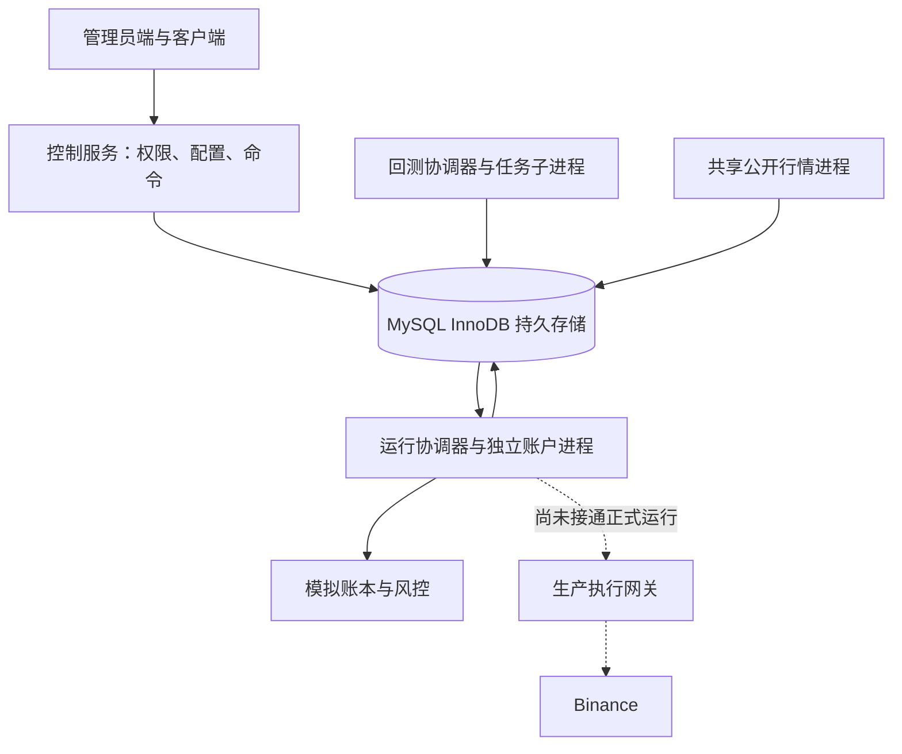

# MK Quant 实现范围与验收清单

本交付已经包含可运行的管理员端、客户端、控制 API、真实历史回测引擎、独立模拟进程及 Binance 适配器。**正式实盘运行闭环尚未完成：控制 API 拒绝启动真实交易，运行进程也会拒绝实盘账户。** 这里把已实现功能与仍需补齐的能力逐项列出，避免把演示数据、接口组件或预留字段视作生产验收结果。

本文是当前实现清单，不是已签署的生产验收报告。没有使用真实 API 密钥、真实账户下单，也没有完成长期压力测试。详细策略语义见 [策略协议 v1.3](STRATEGY_PROTOCOL.md)，新增网格的参数、模拟时序及官方边界见 [USDC 双向网格](GRID_STRATEGY.md)，交易所适配器范围见 [Binance 文档](BINANCE.md)。

## 1. 功能对照

| 需求 | 状态 | 当前行为与剩余工作 |
| --- | --- | --- |
| 管理员创建用户、用户登录、禁止注册 | 已实现 | 管理员创建姓名/手机/登录名/密码；服务端角色鉴权、密码哈希、登录失败节流、HttpOnly 会话及 CSRF 校验；无公开注册接口。生产仍需 TLS、密码恢复与运维制度。 |
| 用户账户 URL 不可猜测 | 已实现，采用随机 ID | 使用 32 位十六进制随机标识，并对每次读取验证账户归属。不是 MD5 加密；MD5 本身也不是加密。知道他人路由不能跨账户读取。 |
| 手机客户端、状态/权益/保证金/订单 | 已实现基础界面 | 日间/夜间主题、响应式资金卡片、持仓/订单、收益曲线、收益及风险指标、复制客户链接、模拟/实盘来源标识；未知数据明确展示。全部生产设备/无障碍验收仍需执行。 |
| 行情下载与本地数据 | 已实现 | 通过 Binance 公开 API 获取 USDT/USDC 现货及永续的 1m 基础数据；策略周期从完整分钟合成；导入按币种分组的 K 线 JSON 并校验 OHLC/时间，界面展示数据起止时间，K 线与研究区间使用北京时间。前端支持简单带列名 CSV 解析；内部历史数据已保存为 Parquet；用户直接上传 Parquet、压缩包及超大数据流式导入尚未提供完整路径。 |
| 自动交易对精度 | 已实现基础规则 | 真实实验绑定交易所规则快照，Decimal 检查 tick/step/min/max quantity/min notional；合成数据规则明确标注。历史时点规则变更、动态价格百分比过滤和完整订单类型规则未复刻。 |
| 策略粘贴/上传/保存与契约校验 | 已实现 | AST 静态读取 MANIFEST，校验参数及账户/币种要求，保存源码哈希；仅管理员可上传，保存即作为可信代码接入，可直接回测/模拟，源码不在 Web 进程执行。 |
| 多种策略及参数表单 | 已实现基础协议 | 内置双均线合约、现货定投及 USDC 双向等比网格；动态标量参数表单，管理员可自定义策略。复杂参数嵌套、组合策略及更多生命周期回调未实现。 |
| USDC 双向 Maker 网格 | 已实现回测/模拟模型 | 五币任意非空子集、各币固定锚点、均分预算、多空交替挂单、独立 lot；GTX 入场/止盈及条件限价止损，无 Taker 回退。不是交易所盘口模拟或真实账户验收。 |
| 训练集/验证集回测 | 已实现 | 不重叠半开区间，各自新账户与状态；策略只读取已完成的合成周期，市价与 Maker 均按后续有效 1 分钟 K 线检查，成交价须落在闭区间 `[low, high]`；组合及逐币费用、曲线、指标和训练/验证对照。不是滚动 walk-forward 或自动防过拟合系统。 |
| 回测运行中曲线、完成统计 | 已实现 | 工作进程分批持久化曲线，页面轮询显示进度，完成后完整计算；中途结果标记未完成。不是 SSE/WebSocket 推送。 |
| 收益/回撤/PF/胜率/夏普等 | 已实现明确定义的模拟指标 | 市价按净持仓、Maker 按关联 lot 的含费减仓事件；缺少样本返回 null，委托与成交分开计数。真实资金费/部分成交/强平尚未纳入。 |
| 预设、复制配置、另存 | 已实现基础流程 | 参数预设通过服务端 API 持久保存；复制实验带入策略、参数、数据、区间及费用。新实验保存独立快照；复杂配置分支、审核及版本合并未实现。 |
| 实验记录、参数差异、并排比较 | 已实现基础工作台 | 实验保存源码/参数/数据/引擎/成本/环境信息，可比较实验及训练验证指标；实验数量分页、研究审批、复杂统计显著性检验未实现。 |
| 批量参数、排队、取消、失败/重跑 | 已实现基础工作流 | 参数网格每次最多 50 组，批量校验通过后原子入队；独立队列与子进程、失败原因、取消/重跑。取消可终止无响应子进程，策略卡死另有超时。协调器崩溃恢复仍需实际故障演练。 |
| 图表与报告导出 | 已实现基础导出 | 全量 JSON 报告与权益 CSV 使用流式导出；交互曲线为保留峰谷的有界预览，成交与决策按需分页；另提供当前曲线 SVG 导出；没有完整 PDF 报告或可复排版研究报告生成器。 |
| 决策输入/指标/意图/风控审计 | 已实现回测记录 | 每根决策可追溯；模拟保存最新展示数据与风险事件。逐次决策统一长期索引、留存和客户端可视化还需完善。 |
| 用户实盘凭据接入检查 | 已实现适配器/控制入口 | 验证权限、账户身份、市场、钱包可用资金、模式/杠杆、已有持仓/普通/条件挂单，身份唯一绑定；未知项目不当作通过。尚未通过真实密钥的全链路部署验收。 |
| 自动账户设置调整 | 已实现受控接口 | 明确发起调整后，逐项检查全账户无仓位/挂单，再修改模式/保证金/杠杆并重新检查；不自动转钱、取消订单或接管原仓。需真实交易所端到端验证。 |
| 自动读取手续费 | 已实现基础读取，成本模型部分实现 | 回测表单可选择有凭证账户，按模型读取 Binance 签名 Taker / Maker 费率后编辑；持续模拟使用标注的假设费率。现货方向费/税费/BNB 抵扣、动态费率及资金费仍未完整建模。 |
| 持续模拟管理 | 已实现基础执行闭环 | 独立账户进程，共享 1 分钟闭合 K 线；按模型使用单向账本或双向 Maker 订单簿、lot 与持久快照。暂停保留 Maker 保护，未成交平仓保持 flattening；不是实时盘口撮合。 |
| 逐格 TP/SL 与停止语义 | 已实现模拟模型 | 入场成交即创建保护但最早下一根有效；止损触发当根不成交，同根歧义止损优先；lot 退出取消兄弟单。止损拒单/缺失暂停补仓，保留风险；真实 Algo 与撤单竞态闭环未接入。 |
| 全客户控制与双重确认 | 已实现模拟控制 | 界面两步确认并展示影响账户，命令持久化，状态由执行端确认；实盘命令不会被伪装成已执行交易。服务端仍需生产级幂等请求键/变更审批策略。 |
| 账户/策略/全平台统计 | 部分实现 | 已有基础权益、收益、保证金、持仓及策略分组；持续模拟按 UTC 权益基准计算今日/月度收益和运行天数，当前无出入金；跨账户加权胜率/PF/夏普及完整日期筛选仍需补齐与对账。部分演示数值仅为标注的示例。 |
| 错误/调试日志筛选 | 已实现 | 模拟策略日志按策略/账户保存，页面可筛选；回测策略日志在 decision 中。生产告警、日志轮转/索引/留存权限需部署。 |
| 策略阶段/指标/图表线/原因 | 部分实现 | `emit` 保存 JSON 展示扩展，阶段/指标/原因可审计；任意策略自定义图表线尚未自动绘制。 |
| 一个账户一个策略，可多币种 | 已实现单实例基础约束 | 实例表账户主键、交易所身份唯一绑定、币种约束、共同时间戳；生产跨主机防双执行还需执行网关隔离。 |
| 现货不做空/杠杆 | 已实现 | 声明、资金、成交前检查及单元测试覆盖；不支持现货融资融币。 |
| 单双向与逐仓/全仓全兼容 | 部分实现 | 默认市价模型单向，maker_grid_v1 支持双向独立腿与 lot；两种合约模型均为全仓权益模型。逐仓结算、真实保证金阶梯及强平账本未实现。 |
| 正式实盘运行系统 | 未完成，明确阻断 | 有签名 REST、接入检查、受控设置调整、订单意图日志与查询组件；未接通可验收的长期实盘执行闭环，不能以环境开关直接绕过控制面禁用。 |

## 2. 架构约束对照

| 原始架构要求 | 当前证据与待验收事项 |
| --- | --- |
| 关闭网页/退出登录/重启 Web 不影响运行 | Web 不持有回测/模拟进程生命周期；需要用独立进程或 supervisor 启动。宝塔部署已验证单独重启 API 后回测与运行进程 PID 保持不变；长期持续运行仍需观察，实盘持仓管理尚未实现。 |
| 回测与运行资源分离 | 不同进程入口；回测子进程降低优先级并设 CPU/墙钟超时与 Linux 默认 2 GB 地址空间上限（不是常驻内存预留）。账户进程 Linux 默认 384 MB 地址空间上限、单次 on_bar 10 秒截止时间；容器另设 CPU/内存/PID 限额。网络连接、磁盘 IO 与总容量仍须实际压测。 |
| 单个策略异常不能拖垮其他客户 | 每账户独立进程，异常记录并停止继续开仓；Unix 信号超时和租约心跳检测可终止卡死策略，回测单任务子进程。仍需内存暴涨及大量客户压力演练。 |
| 同一实际账户仅一个有效执行者 | 本地实例租约、递增 fence 与提交前校验，实际账户身份唯一绑定；这些保护已用于模拟持久化。真实下单的“检查后暂停再恢复发送”竞态，必须由单一持钥执行网关/基础设施强制隔离旧进程解决。 |
| 所有管理指令持久化 | 命令 ID、账户、动作、发起人、状态、结果/错误和时间入库；需补生产幂等键、重放与故障恢复演练。 |
| 运行状态来自执行端 | `desired_state` 与 `observed_state` 分离，租约过期显示 unknown；仍需验证不同故障条件下的旧状态不冒充实时。 |
| 订单/成交/账本/停止标记持久保存 | 模拟 fill、snapshot、runtime_events 和控制状态使用 MySQL InnoDB；Maker 委托生命周期、lot、保护、事件和策略状态随快照事务保存，真实网关有独立订单意图日志。需要备份恢复、增长控制、归档与 DB 损坏演练。 |
| 行情订阅统一复用 | 独立行情进程按市场/币种汇总请求、写共享行情缓存；当前为 REST 轮询与单机缓存，没有 WebSocket 多级分发或跨进程/IP 限流中心。 |

策略接口、账户模型、按执行模型划分的市价/Maker 订单语义、基础风控与指标在回测和模拟之间复用。正式实盘仍缺独立执行网关和交易所事件账本，不能把“接口已共用”描述为“三环境语义已完整一致”。

## 3. 已有验证与如何复验

先配置专用的 `_test` 结尾 MySQL 库及 `MK_TEST_ALLOW_RESET=1`，再运行 `python -m pytest -q`；应用依赖安装在虚拟环境时使用该环境的 Python。2026-11-02 的历史基线是在真实 MySQL 5.7 / Linux 环境 70 项通过，该记录早于本次网格功能，不能用来证明新增运行链路已验收。当前测试范围包括：

- 策略契约、字段校验、现货约束、静态校验不在控制进程执行上传源码。
- 完整分钟连续性、严格相同的多币时间轴、闭合高周期合成、历史不可见未来、信号最早下一分钟撮合及最后信号不补成交。
- Decimal 精度、数量与名义金额过滤、费用及分摊、资金不足、只减仓不反手、现货不做空。
- Maker 双腿独立、固定锚点与五币子集、预算均分/多空交替、稳定委托 ID、资金预留、后续有效分钟闭区间触价/零量不成交、保护价量化、同根保护不成交、止损先处理、逐 lot 成本和兄弟取消。
- Maker 订单簿 JSON 恢复、重复 K 线不重复成交、被动平仓未成交不宣告停止；持续模拟需另用真实 MySQL 验证持久提交和命令状态。
- 收益/回撤/PF/连续亏损口径、空样本 null、训练验证独立账户、确定性合成行情、取消/进度。
- Binance 注入运输层的签名、限流、接入检查及订单意图幂等/不确定状态；不是实际下单测试。
- 控制面权限/跨账户隔离、命令持久化、租约、模拟恢复与回测工作进程集成，具体用例以仓库测试文件为准。

集成验证使用独立的真实 MySQL 数据库，覆盖合成行情的真实工作进程路径、事务回滚与并发租约/订单幂等；不使用 SQLite 或内存替代库。服务器还使用真实 BTCUSDT 1 小时公开行情执行 1,440 根的回测/验证，各 720 根，完成并保存 102 笔模拟成交；模拟恢复/停止开仓/平仓停止命令均取得回执，验收账户最后已停止。部署复现方法见 [宝塔部署指南](../deploy/BAOTA.md)；公开仓库不包含具体部署地址与账户凭据。这些测试验证流程，不作为策略绩效证据。部署使用可信证书，不能关闭 TLS 验证绕过。

2026-11-02 已完成隔离开发库到专用测试库的 MySQL＋Parquet 联合备份恢复演练：20 张 InnoDB 表、44 行记录的行数及内容哈希一致；5 个 Parquet 文件校验一致，可完整回读 1,440 根 K 线及 1 个实验的 1,440 个曲线点。备份正确排除 `.writing-*.parquet` 临时文件，开发源数据和生产数据未改写。

人工端到端验收建议按以下顺序执行，并记录环境、数据哈希、截图、日志及结果：

1. 管理员登录并创建真实的独立模拟账户；用户登录只能查看自己的账户，复制另一个随机路由也读取失败。
2. 导入可校验的短小 OHLC 数据，运行已知交易序列，对照下一根开盘价格、手续费、保证金和最终权益。
3. 管理员保存合法自定义策略后直接运行同一短数据集；确认字段缺失/语法错误被拒绝，普通客户端不能上传，源码版本及 SHA-256 与实验一致。
4. 启动共享行情与模拟进程，确认数据来源及时间；关闭浏览器、退出登录并重启控制服务，观察运行进程继续写账本。
5. 停止开仓、恢复、平仓并停止，每次检查命令 ID、执行端确认、剩余持仓及失败原因；停止状态跨进程重启保持。
6. 令行情过期/断档，确认禁止新仓和作废过期意图；恢复行情后不补发历史开仓。使策略抛异常，确认其他账户不受影响且错误状态不冒充已平仓。
7. 取消/失败/重跑实验，确认中途曲线标记未完成、训练验证不重叠、原实验配置不被覆盖、导出含正确来源和成本假设。
8. 只用专门测试账户执行 Binance 接入检查和明确批准的账户设置调整；保存前后设置及每步结果。该步骤仍不等于正式实盘验收通过。

新增网格的定向人工复验还必须覆盖：

1. 五币全选及任意子集分别启动独立模拟实验；确认各币预算与双方向分配，非法交易对、非零 Maker 滑点及不满足止损组合约束的参数被拒绝或清楚失败。
2. 构造入场当根跨越 TP/SL、仅触价、跳空触发、同根双触发、止损限价始终不成交的数据；核对没有使用未知先后伪造成交，触发/拒绝/未成交均保留仓位风险。
3. 暂停后只撤入场，保护继续；平仓请求后保留 `flattening` 和进行中的命令，实际退出前不显示成功。行情过期时不撮合，恢复后不补发过期入场。
4. 在存在 lot、挂单、触发后止损和 flattening 四种状态下重启账户进程，对照订单 ID、数量、费用、保护及事件，确认无重复成交；验证配置更新不覆盖未平风险。

网格的自动化入口见 `tests/test_grid_strategy.py`、`tests/test_maker_engine.py`、`tests/test_maker_runtime.py`；运行与数据库用例以当前测试文件和实际执行记录为准。上述新增人工项目未记录通过前不得描述为生产验收完成。

2026-11-03 的新增验证已在 Linux、真实 MySQL 5.7 专用测试库运行：完整套件 **117 项通过**，包括 44 项引擎、6 项网格策略、17 项 Maker 运行/API 用例。覆盖订单与成交分离、逐 lot 保护、失效租约不提交、事务整体回滚、空仓跨模型切换保留账本与订单身份、北京时间日/月收益边界、无变化心跳和参数/资金校验。前端构建及 4 项北京时间测试通过；开发环境用公开行情形成 40 笔模拟挂单、0 笔成交，随后撤单并确认停止。1440×900 桌面和 390×844 手机验证了独立 to-do 入口、Maker 参数、挂单字段和过期状态；没有执行真实交易。

同日发布后，服务器通过原生独立回测进程完成五币种公开历史行情烟测：北京时间 2026-10-19 至 11-02，每币 336 根 1 小时 K 线，训练/验证各 168 个共同时间点，共记录 525 笔模拟 Maker 成交及 2,292 个委托事件。两组期末合计保留 66 笔未成交单和 9 个未平 lot，未强行平仓美化结果；曲线、成交、完整决策事件存入 Parquet，JSON 报告可导出。生产既有账户权益和停止状态保持一致。最后资料编辑不重置执行版本的调整，另通过 5 项 API 定向回归。

## 后台下载与入口精简验证（2026-11-03）

历史下载改为 MySQL 持久任务，由独立研究工作进程串行调度。控制 API 只提交任务并返回 202，页面按服务端状态禁用按钮；切页、刷新和 API 重启不清除任务。任务分页更新进度，失败保留原因，完成后统一发布数据集与 Parquet 引用。最多同时一个活动下载，单次总计不超过 100000 根；默认墙钟 900 秒、Linux 地址空间 768 MB，过期租约最多尝试三次（含首次）。

Linux + MySQL 5.7 的下载/API/Binance/MySQL/Parquet 相关回归 **63 项通过**，其中下载任务 13 项，覆盖并发去重、提交幂等、权限与 CSRF、进程重启、过期租约隔离、事务回滚、网络错误、真实超时异常链、残留回测进程互斥及受限独立子进程。隔离开发库通过浏览器提交 BTCUSDC 公开 1 小时行情，切页、刷新、重启 API 后仍保持同一排队任务和禁用按钮；独立研究子进程随后下载 2160 根并保存 Parquet，完成后按钮恢复可用。

独立用户管理入口已合并到模拟/实盘页，旧地址跳转模拟页；新建账户默认环境分别为模拟/实盘。浏览器验证两种默认值和不同策略参数预设互不混列；删除指定的实验、账户表尾说明和总览管理账户按钮。前端构建通过，桌面及手机检查了任务卡片和日期控件。

同日生产更新前完成 MySQL/Parquet 联合备份；只重启 API 和研究进程，运行协调器 PID 保持不变。上线后后台完成 BTCUSDC 与 ETHUSDC 各 24 根公开 1 小时 K 线下载，提交响应约 0.04 秒，排队中及完成后使用同一请求编号均复用原任务；原账户权益与停止状态一致。

## 分钟撮合与逐币结果：开发验收（2026-11-03，1.3.0）

本节记录隔离开发环境和专用测试库的结果，**不代表 1.3.0 已部署生产或正式实盘已经验收**。旧版公开小时行情的验收记录保留为历史证据，不适用于新撮合语义。

- 公开下载和本地新导入只接受 `1m`；省略周期默认 `1m`，显式传入其他周期返回 422。每币时间戳必须分钟对齐、连续，组合交易对具有完全一致的时间轴；现有小时数据与历史实验保留只读，新回测明确要求重新提供分钟数据。
- 策略 `timeframes.primary` 与附加周期从完整分钟聚合，仅在主周期闭合后产生决策；持续模拟持久化合成窗口，重启后不重复决策或成交。撮合始终逐分钟进行，所有成交价满足对应分钟 `low <= price <= high`。分钟内真实价格先后、盘口排队及部分成交仍不在当前模型范围。
- 同一次组合执行产生总结果与各币归因。初始资金等分作为逐币基准，保留共享资金与共同执行结果；逐币权益可加总为组合权益，不把各币重跑当作归因。训练/验证各自独立，分别保存指标、权益、差异和归因说明；新实验绑定 `base_interval`、策略周期、源码及引擎版本快照。
- Linux / MySQL 5.7 完整套件先通过 161 项，后续版本保护与引擎定向回归 31 项、API 定向回归 1 项，以及报告内存修复后的 storage/API 12 项均通过；去重后覆盖当前 **166 个独立测试**。这是分批验证记录，不是单次完整 166 项运行。新增测试覆盖高周期合成、分钟撮合、逐币加总、Parquet 分组恢复、内置版本升级保护、流式报告等价、明细分页和提前关闭文件迭代器。

开发库从 Binance 下载 BTCUSDC、ETHUSDC、SOLUSDC、BNBUSDC、XRPUSDC 五币真实公开 1 分钟行情，共 28,800 行。五币网格形成 215 笔模拟成交；使用分钟数据合成 1 小时的双均线形成 4 笔成交。逐笔核对全部成交价格均在原始分钟高低价范围内。两次实验的训练/验证分别保留 2,880 个组合曲线点，所选每个交易对各保留同样点数，逐点加总验证通过。以上只验证流程，不作为策略盈利能力证明。

大报告验证使用上述五币网格的 215 笔成交与 5,760 条决策。原接口一次性展开 Parquet 后再次编码，单次约 24.73 MB JSON 的 API 峰值 RSS 为约 450 MB；改为 32 行批次流式输出，单次峰值约 128 MB，两份同时读取约 149 MB。五轮交互预览与决策分页保持约 122 MB；三次中途断开后 Parquet 文件句柄归零。完整 JSON 验证仍含全部成交、决策、组合及五币训练/验证曲线；CSV 仅读取权益文件。该结果是有限并发开发检查，不是长时间或任意规模容量保证。

交互详情明确返回每条曲线不超过 600 个保留极值点，并显示预览状态；完整统计仍由所有数据计算。交易与决策使用独立分页接口，响应包含总条数和是否有下一页。完整详情 API 与 JSON/权益 CSV 导出保持全量，发送响应前校验所需文件路径及哈希；无数据、未记录与未完成状态不能被补造成完整结果。旧实验没有逐币记录时，应重新用 1m 数据创建新实验。

本次引擎与运行进程共用语义已改变，上线须按 [宝塔部署指南](../deploy/BAOTA.md) 预检、备份并重启 API、研究、运行三个角色及更新前端，保留旧数据、实验与策略版本。生产发布验收见下节。

### 2026-11-03 生产发布复核

发布前确认账户均已停止，持仓、活动回测、下载和待处理命令均为零；已完成 MySQL/Parquet 联合备份及原版本源码归档。通过原有宝塔项目更新并重启 API、研究、运行三个角色，健康接口返回引擎 `1.3.0`、MySQL/InnoDB 与 Parquet，实盘执行闸门保持关闭。

- 生产重新下载五个 USDC 交易对的真实 1m 行情，共 28,800 根；四天区间拆为独立两天回测集及两天验证集。
- 五币网格产生 215 笔成交，分钟合成小时的双均线产生 4 笔成交。所有成交逐笔与源分钟 `[low, high]` 核对通过；小时策略仅在完整小时收盘后决策。
- 汇总和每币训练/验证曲线各 2,880 个点。逐时刻各币权益相加等于组合；手续费、已实现/浮动盈亏、成交数及最终权益可加总，CSV 包含汇总与所有币种。
- 两个原有模拟账户的权益和停止状态保持一致，未启动实盘。旧实验结果仍可读取。
- 浏览器检查汇总/单币指标、曲线区间、验证对比与明细分页。1440×900、1920×1080、390×844 视口及日夜主题检查通过；手机按钮换行且无页面横向溢出。前端构建和四项北京时间展示测试通过。

正式实盘能力边界与下面的待验收项目不因本次研究功能发布而改变。

### 2026-11-03 数据集管理与无总量上限下载

管理员可删除未被实验引用的数据集目录记录；保留下载日志与审计，已有实验引用返回 409，数据集删除与实验入队通过行锁互斥。不可变文件保留用于共享引用和备份恢复，不在接口内直接回收磁盘。

历史下载取消 100000 根及固定总时长限制，逐页读取并以约 32000 行 Arrow 缓冲写入 Parquet。动态请求权重、至少 0.5 秒间隔和 429/418 完整 Retry-After 等待控制频率，等待期间持续续租，进程恢复先遵守持久冷却时间。无进展看门狗、地址空间、磁盘预留及失败清理仍有效。

Linux/MySQL 定向回归 96 项通过，覆盖 downloads/storage/binance/delete/API；最后的缓冲调整后，downloads/storage 36 项复测通过。受 768 MB 地址空间限制的独立子进程处理 100005 根、101 页行情，峰值 RSS 112836 KB（约 110.2 MiB）。覆盖模拟 1200 秒限流等待、租约接管、停滞、磁盘不足、共享文件、旧逻辑哈希和临时文件清理；不向币安故意制造限流。

生产已完成发布前联合备份，通过原有宝塔项目重启 API 与研究进程，运行角色 PID 保持不变。实际下载 BTCUSDC 2026-08-24 00:00 至 2026-11-03 00:00（北京时间、结束不含），共 102240 根；逐分钟连续性与文件 SHA-256 校验通过，下载子进程峰值 RSS 106688 KB（约 104.2 MiB）。切页后任务继续且下载按钮保持禁用，完成后数据集列表正确显示全部数量。临时 3 根合成数据的删除确认窗、接口删除、列表移除和审计保留验证通过；既有账户权益与状态未改变。

## 4. 正式实盘上线前必须完成

以下每项都应有实现、自动化测试或演练记录及明确通过标准；未通过时保持实盘闸门关闭。

1. **运行期授权与强制单执行者。** 把密钥和网络出口集中到独立网关，拒绝旧 fence；验证旧进程在租约失效后从暂停恢复也无法下单。分离“初次空账户接入检查”和“已有受管持仓的运行授权续期”，不能每 60 秒要求账户空仓续期。
2. **交易所事件与对账。** 接入用户数据事件流，处理断线续订、重复/乱序、部分成交、成交费用、撤单、过期、资金费、出入金、外部手工交易；定期 REST 对账。未知订单必须按同一个 clientOrderId 查询，不能盲目重复下单。
3. **持久执行状态机。** 订单意图、发送前写入、交易所确认、成交、账本变更、故障恢复形成可审计状态机；为网络超时、发送后崩溃、确认前崩溃逐一做故障注入，证明没有重复风险敞口。
4. **真实风险与保证金模型。** 完成账户及币种可用保证金、标记价、维持保证金阶梯、真实双向持仓对账、逐仓/全仓、强平、资金费、稳定币钱包及兑换处理；模拟双腿账本不能替代这些项目，未经实现的模式拒绝启动。
5. **紧急控制闭环。** 暂停后确认不能新增风险；撤普通/条件挂单、处理在途单，再平仓并确认交易所仓位，失败时保留任务和残余风险。网格实盘需 GTX 普通单、Algo STOP、实际成交增量保护、逐 lot 分配和兄弟撤单竞态控制，目前尚无完整下单链路。Maker 止损/平仓无法保证退出；任何另行设计的 Taker 应急退出都必须显式定义，不能偷偷回退。
6. **策略代码与凭据隔离。** 非可信代码使用真正的 OS/容器沙箱，禁止接触控制数据库、密钥与任意网络；独立 CPU/内存/进程/磁盘限额。建立源码审核、签名/哈希、回滚和密钥轮换制度。
7. **部署与容灾。** TLS、可信 CA、NTP、进程守护、优雅关闭、数据库备份/恢复演练、磁盘满处理、日志留存、监控告警、容量测试；把交易账户工作进程与批量研究任务划分资源预算。MySQL 与 Parquet 必须联合备份恢复；达到单机容量边界前规划数据库高可用与文件存储扩展。
8. **账户身份与外部活动。** 验证不同 API Key 绑定同一实际账户必被拒绝；明确专用账户边界、已有订单/仓位接管规则；运行中发现外部交易或账本差异时停止新增风险并告警，不能只依赖接入瞬时快照。
9. **交易所验证与限额。** 使用测试环境/专用受限账户覆盖实际可用接口、权限、精度、最小金额、限流、时钟漂移、不同市场/USDT/USDC；测试环境不支持的检查保持 unknown，不冒充生产权限通过。
10. **可追溯业务统计。** 从持久成交与资金事件重建每日/月度/累计净收益，定义 UTC/本地时区切日、入出金对收益率的影响和跨账户加权口径；核对客户端、后台、导出与交易所账单一致。

## 5. 数据来源与运行约定

演示账户、示例收益及合成 K 线必须持续标注。演示账户不能启动真实运行；需要管理员另建独立模拟账户。无真实账户快照的实盘账户余额为未知，不能用输入的初始模拟金额冒充交易所权益。

配置变更只能在停止并获得执行端确认后进行。市价模型修改策略 ID、源码或配置修订后，清空旧策略状态和待执行意图并保留金融账本；Maker 模型还要求 lot 和挂单均清空，禁止覆盖仍有风险的订单簿。策略状态只允许严格 JSON 数据，跨模式详细约定见策略协议。

管理员是策略源码的信任边界，正常上传保存后即可回测/模拟。旧策略记录的可选运维启用命令为 `python -m backend.worker trust-strategy STRATEGY_ID --source-hash SHA256 --accept-trusted-code`，会校验精确源码；它不是日常上传的额外步骤，也不能代替沙箱或实盘验收。不要把 `MK_ENABLE_LIVE` 当作已完成上线验证的证明。

需求中“每次只写策略逻辑”的目标已形成基础接口和可运行回测/模拟链路；正式实盘、完整账户结算及生产运维的剩余内容以上表和上线清单为准。

## 数据集与实验文件清理

数据集删除升级为数据库记录与未共享 K 线文件清理，实验记录增加删除按钮与确认弹窗，返回实际释放容量。已完成、失败、取消实验可删除；排队和运行任务阻止删除。共享结果文件保留到最后一份实验引用删除，实验删除后可继续删除不再引用的原始数据集。交易账户、账本、下载回执和审计保留。

验证覆盖权限与 CSRF、活动任务保护、四类实验文件清理及共享引用、删除事务回滚不删文件、文件清理失败后的持久重试、重试前出现新引用时保留文件，以及跨进程生命周期锁。联合备份与发布、清理使用同一锁；生产验证只使用本次创建的临时记录，既有数据保持不变。

本次 MySQL/API/下载/存储回归 84 项通过；新增进程锁与路径安全检查后，存储专项 19 项通过。前端生产构建通过，1440×900 与 390×844 浏览器确认删除弹窗和运行中禁用状态正常。生产临时回测完成后删除 4 个结果文件，释放 212172 字节；共享数据集保留到最后引用删除，再释放 210866 字节。新联合备份中的文件 SHA-256 在在线删除后仍通过校验；临时记录已清理，既有账户状态保持不变，交易运行进程未重启。
